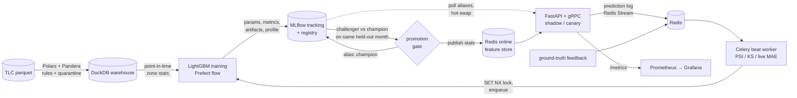

# driftline

**A closed-loop MLOps platform: validated data pipeline → experiment tracking → gated model
registry → shadow/canary serving over REST and gRPC → drift monitoring → automatic retraining.**

Built on 12 months of real NYC TLC yellow-taxi data (~38M trips, 2024) to predict trip duration.
The model is deliberately ordinary (LightGBM); the point of the project is everything around it:
the parts that decide whether a model is still right six months after it ships.



## Results (all measured, reproducible with the commands below)

**Model** (train Jan–Feb 2024, evaluate on all of March, 3.45M trips after validation):

| | MAE (min) | p90 abs error | within 3 min |
|---|---|---|---|
| Baseline: "same route took X last month" | 4.67 | 9.92 | 52.3% |
| LightGBM, 14 features | **2.90** | **6.32** | **70.3%** |

**Walk-forward backtest, Apr–Dec 2024** (`scripts/backtest.py`): at the start of each month only
past labels are visible. Every strategy is scored on that month's real trips.

| Strategy | Mean MAE, 9 months | Dec 2024 | Retrains / promotions |
|---|---|---|---|
| Frozen model + frozen features | 3.628 | 4.733 | 0 |
| Frozen model, features refreshed monthly | 3.637 | 4.779 | 0 |
| **driftline loop** (2-month training window) | **3.415 (−5.9%)** | **4.183 (−11.6%)** | 2 / 1 |
| driftline loop (4-month training window) | 3.417 (−5.8%) | 4.120 (−13.0%) | 4 / 2 |

Findings worth reading:
* **The promotion gate prevented a regression.** In October the loop retrained on Jul–Aug.
  That summer-only model was **4.4% *worse*** on September than the current champion, so the
  gate rejected it and kept serving the better model. Without a gate, the retrain would have made
  things worse.
* **Refreshing features alone does nothing** (3.637 vs 3.628). The traffic regime shifts, and
  only retraining the model recovers accuracy.
* A longer training window got its retrains promoted (no summer-only model) but needed twice as
  many retrains to reach the same mean error. The 2-month window is the default.

**Serving** (MacBook, 10 cores, REST, real April trips, load generator on the same machine):

| | value |
|---|---|
| In-process feature build + champion + challenger + log | p50 0.48 ms, p99 0.66 ms |
| HTTP, 4 workers, concurrency 8 | **838 req/s, p50 3.7 ms, p99 20.8 ms, 0 errors** |
| Pinning Polars to 1 thread per process | p99 at concurrency 32: 301 ms → 229 ms (CPU-bound beyond that) |

**Data quality.** About 3.4M raw rows per month are validated and loaded in **under 0.5 s**.
3.4–3.8% of rows are quarantined with a reason (`distance_out_of_range`, `unknown_zone`,
`duration_out_of_range`, `implausible_speed`, `pickup_outside_month`) instead of being dropped
silently. If a month's quarantine rate goes above 15%, the pipeline stops.

**Closed loop verified in Docker Compose.** The stack served real September traffic with feedback
to a model trained on Jan–Feb. The Celery worker computed **live MAE 3.98 (+37% vs offline 2.90)**
and enqueued a retrain under a Redis lock. The gate promoted v2 (**+16% MAE gain**) and the flow
published fresh online features. The API hot-swapped to v2 through registry polling with **no
restart**. Live MAE on the next traffic matched v2's offline estimate (4.01 vs 4.01).

## Design decisions

* **Point-in-time features.** Zone statistics (median duration per route, median speed per zone
  and hour) for month *M* come only from month *M−1*. The model never sees an aggregate that
  contains its own target. For the same reason, serving uses stats from the newest labelled month.
* **One feature function for training and serving.** `base_features()` runs vectorised over
  millions of rows offline and on one row online. A test asserts byte-identical model input both
  ways, which rules out train/serve skew.
* **Native categoricals as raw ints.** No category-code mapping exists that could differ between
  training and serving.
* **Atomic feature publishes.** Each version is written to `fs:{month}:*` and a single
  `fs:current` pointer is then flipped. The old version expires rather than being deleted, so a
  reader holding the old pointer never misses. The serving side caches the pointer for 2 s, so a
  lookup is one Redis round trip.
* **Registry aliases as the deployment interface.** `champion`, `challenger` and
  `previous_champion` live in MLflow. Serving polls the aliases and swaps a whole bundle (model,
  zone stats, drift profile) atomically. Rollback is one alias move: `driftline rollback` or
  `POST /admin/rollback`.
* **Shadow and canary.** Shadow mode serves the champion and also scores the challenger, logging
  both and exporting `|Δ|` as a histogram. Canary mode uses deterministic blake2b bucketing on the
  request id: assignment is sticky, and the measured share is within ±2% of the target.
* **Monitoring that judges the right model.** Drift profiles (quantile-binned PSI plus KS
  samples, top-K categoricals) are saved with each model version. The worker only evaluates
  records served by the current champion. Retraining requires PSI > 0.2 on *key* features or
  >10% live-MAE degradation, with minimum sample sizes. The same `retrain_reasons()` policy runs
  in the live worker and in the backtest.
* **Failure isolation.** A failed prediction-log write never fails a prediction (it increments a
  counter). A registry outage keeps the current models serving. Celery uses `acks_late`. The
  retrain lock (`SET NX EX`) allows one retrain per cooldown across any number of workers.

## Stack

Python 3.13 · Polars · DuckDB · Pandera · LightGBM · MLflow (tracking + registry, Postgres
backend) · Prefect · FastAPI · gRPC/protobuf · Redis (online store, Streams, locks) · Celery
(+beat) · Prometheus · Grafana · Docker Compose · Kubernetes (Kustomize, HPA, PDB, probes,
CronJob) · GitHub Actions · pytest · ruff

## Run it

```bash
make install                 # python3.13 venv + editable install
make data                    # download Dec 2023 – Dec 2024 from the TLC CDN (~730 MB)
make train                   # Prefect: ingest → train → gate → publish features
make serve                   # REST on :8000   (make grpc for :50051)
make loadtest
make backtest                # ~25 min on a laptop; writes results/backtest_w{2,4}.json
make test                    # 25 tests, synthetic data, ~1 min
```

Full stack (Redis, Postgres + MLflow server, API, gRPC, Celery worker + beat, Prometheus, Grafana):

```bash
cp .env.example .env         # then set POSTGRES_PASSWORD
docker compose up -d --build
docker compose --profile jobs run --rm trainer driftline train --train 2024-01 2024-02 --eval 2024-03
# Grafana http://localhost:3000 (dashboard "driftline — serving & drift"), MLflow http://localhost:5000
```

Every host port can be overridden (`API_PORT`, `REDIS_PORT`, `MLFLOW_PORT`, `GRPC_PORT`,
`PROMETHEUS_PORT`, `GRAFANA_PORT`).

Kubernetes: `kubectl apply -k deploy/k8s`. It deploys the API pod (REST and gRPC containers,
startup/readiness/liveness probes, HPA 2–10 on CPU, PDB, zero-downtime rolling update), the
Celery worker, a single-replica beat (so scaling workers never duplicates the schedule), Redis,
MLflow, and a monthly CronJob that ingests the new TLC month and refreshes the online features.
CI renders the manifests and validates them with kubeconform.

## API

| Endpoint | |
|---|---|
| `POST /predict`, `POST /predict/batch` (≤1000) | prediction, model version and role, shadow value, feature version |
| `POST /feedback` | ground truth for a `request_id`, used for live MAE |
| `GET /models` · `POST /admin/reload` · `POST /admin/rollback` | registry state and control |
| `GET /monitoring/drift` | latest worker report (PSI/KS per feature, live MAE, reasons) |
| `GET /health` · `GET /ready` · `GET /metrics` | liveness, readiness (champion loaded), Prometheus |
| gRPC `TripDuration.Predict / PredictBatch` | same predictor, binary protocol |

## Layout

```
driftline/
  data/        ingest.py (raw → DuckDB, idempotent per month) · validate.py (rules + Pandera contract)
  features/    build.py (shared feature code, point-in-time ZoneStats) · online.py (Redis / in-memory store)
  training/    train.py (LightGBM + MLflow) · registry.py (bundles, promotion gate, rollback)
  monitoring/  drift.py (PSI, KS, profiles) · checks.py (retrain policy) · tasks.py (Celery + beat)
  serving/     predictor.py (routing, logging) · app.py (FastAPI) · grpc_server.py · metrics.py · proto/
  pipeline/    flows.py (Prefect: ingest, train-and-promote, refresh-online-features)
scripts/       backtest.py · loadtest.py · fetch_month.py
deploy/        k8s/ · prometheus.yml · grafana/
```

> **macOS note:** if `import driftline` fails inside the venv, a sync tool may have set the
> `hidden` flag on the editable-install `.pth` file, and Python 3.13 skips hidden `.pth` files.
> Run `chflags nohidden .venv/lib/python3.13/site-packages/*.pth`. The Makefile also sets
> `PYTHONPATH` so this doesn't come up.
